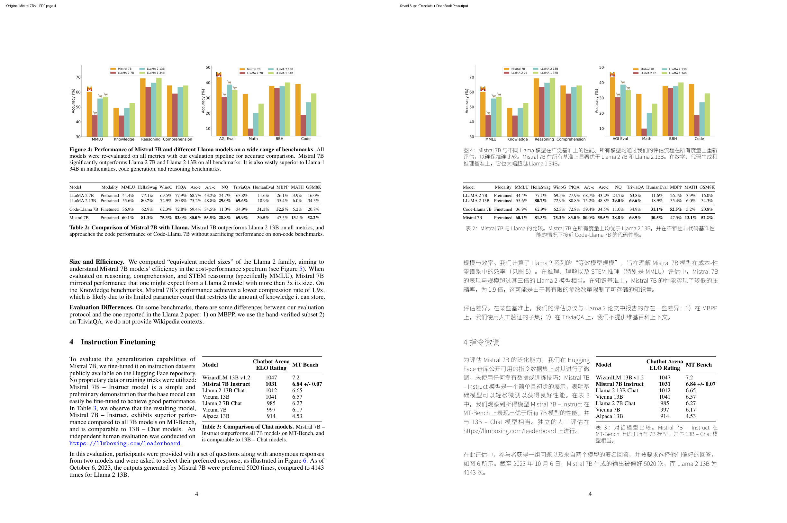
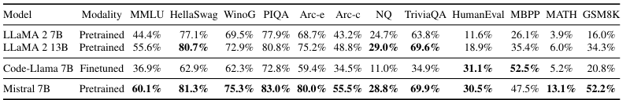
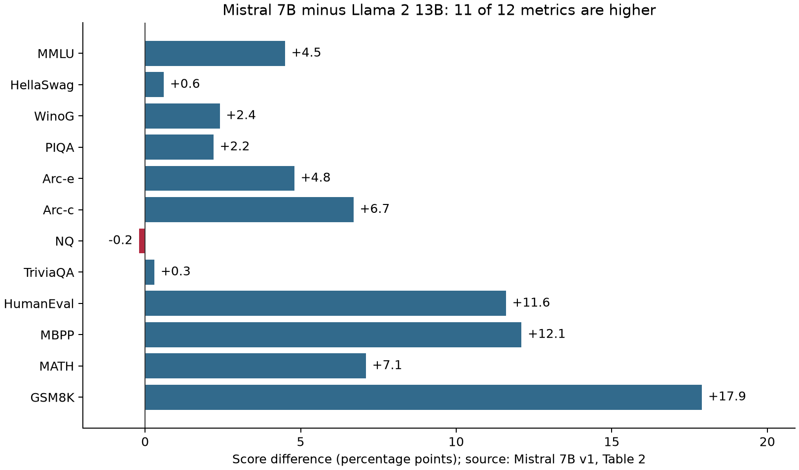

# 图表没变，结论就可信吗？用 SuperTranslate 阅读 Mistral 7B 并核查表2

本例发现了一个容易漏掉的问题：**保存图表原貌，可以保护证据；它不能保证阅读报告正确使用证据。** SuperTranslate 生成的中文 PDF 中，图4、表2、表3的指定区域与原文逐像素相同，引擎检查也报告 0 issue / 0 error。然而，配套 AI 阅读报告仍重复“在所有指标上优于 Llama 2 13B”。原论文表2中的 NQ 为 **Mistral 7B 28.8%，Llama 2 13B 29.0%**，相差 −0.2 个百分点。

这篇分享提供一份真实输入、未经修正的 AI 输出、实际请求与执行记录、逐项数值核查和可离线运行的检查脚本。范围是一篇论文的一页，不是模型性能复现，也不据此评价整个工具或整篇论文的可靠性。

## 1. 阅读问题与实践来源

论文为 Albert Q. Jiang 等人的 [Mistral 7B，arXiv:2310.06825v1](https://arxiv.org/abs/2310.06825v1)，2023-10-10 版本。本材料使用原 PDF **第4页**，包含图4、表2、表3、“Size and Efficiency”“Evaluation Differences”和指令微调段落。原页片段在 [paper/input.pdf](paper/input.pdf)，可检索文本在 [paper/source.txt](paper/source.txt)，引用与授权在 [SOURCES.md](SOURCES.md)。这些材料随仓库和提交包提供。

原始实践于 **2026-10-27** 完成：将这一页译成保留版式的中文 PDF，同时生成带位置的阅读记录。完整任务与验收条件保留在 [TASK.md](practice/TASK.md) 和 [ACCEPTANCE.md](practice/ACCEPTANCE.md)。本次技术分享复用该实践中的 `B-with-pro` 会话，事后聚焦“表2是否支持所有指标均更高”这一问题。没有为了这篇分享重跑推理，也没有把事后核查问题伪装成原始提示词。

使用的开源项目是 [asimfish/super_translate](https://github.com/asimfish/super_translate)，冻结在 commit `f16a641b9c7be155938d6b0e047b24e944dd4668`，翻译引擎未经修改。本仓库是独立的使用实践与核查记录，上游引擎的作者、功能和许可归属见 [SOURCES.md](SOURCES.md)。

## 2. 方法：把翻译、保真检查、结论核查分开

处理过程分为四步：

1. 用 PyMuPDF 检查原页尺寸与文本层，将 PDF 作为版式和表格列对齐的依据。单独抽取的纯文本会打散表格，不能只根据文本出现顺序判断列归属。
2. 使用 SuperTranslate 的 `translate`，开启 `--preserve-graphics-text`，显式指定中文字体。翻译正文、标题和图注；图形、表体和图内英文标签尽量保持原样。输入与输出分开保存。
3. 运行引擎 `inspect`，并让同一阅读助手生成双语段落审阅记录、检查结果和阅读报告。这一步产生的是 **AI 自报的检查与解读**。
4. 在会话结束后，另用脚本核对原图与译图的固定区域、原表与译表的数值，并逐项计算模型之间的差。这里的检查不调用语言模型。



图1：左侧是论文原页，右侧是实际生成的译页；仅添加左右说明和留白。论文与译页见 [SOURCES.md](SOURCES.md)。这张总览适合观察布局，精确比较使用下面列明的区域与原始 PDF。

实际环境是 Windows / Python 3.12.5、PyMuPDF 1.25.2。请求模型标识为 `deepseek-v4-pro-0813`，服务返回 `deepseek-v4-pro-ga-260813`；温度为 0，thinking 禁用，未固定随机种子。服务通过玻尔的模型推理网关调用，**没有使用玻尔科学空间进行这次实践**。原 AI 报告把模型写为“本地模型”；准确说法是本地代理转发到网关，并非在本机部署 DeepSeek。

完整环境字段在 [environment.json](practice/environment.json)。原会话提供 `read_file`、`list_files`、`execute_python` 三个工具，没有把截图直接作为图像输入交给控制模型的工具。因此，模型自述“字形正确”等说法不能单独算作视觉验收证据。

## 3. 原始 AI 输出与核查结果

### 3.1 排版保真：三处指定区域一致

原始 [译文 PDF](practice/out/translated.pdf)、[阅读记录](practice/out/reading-audit.json)、[阅读报告](practice/out/output.md) 和 [引擎 inspect 结果](practice/out/inspect.json) 均原样保存。阅读报告中的错误没有被修正后替换。

独立检查以 PyMuPDF 的 PDF 点坐标裁剪，在 2 倍分辨率、RGB、无 alpha 的相同条件下渲染：

| 区域 | 原页坐标 `[x0,y0,x1,y1]`，单位 pt | 平均绝对 RGB 差 / 255 | 不同像素比例 |
|---|---|---:|---:|
| 图4图形区域 | `[106,75,506,198]` | 0 | 0 |
| 表2表体 | `[106,260,506,324]` | 0 | 0 |
| 表3表体 | `[313,531,503,633]` | 0 | 0 |

页数和页面尺寸也相同。这只证明指定区域在本次渲染条件下没有像素变化；不证明所有段落翻译正确、不证明图注结论成立，也不验证原论文的训练或评测实验。

### 3.2 表2核查：量词“所有”被一个单元格反驳

论文表2表注包含短语 “outperforms Llama 2 13B on all metrics”。AI 阅读报告“核心阅读结果”第2项复述了这一全称判断，但没有指出 NQ 反例。报告末尾虽笼统提醒“作者主张未独立验证”，也没有把这一具体冲突呈现给读者。



图2：从随包原始 PDF 渲染的表2表体；数值与列标题可直接核对。来源为 Mistral 7B v1，第4页，Table 2。

| 指标 | Llama 2 13B | Mistral 7B | 差值（百分点） |
|---|---:|---:|---:|
| MMLU | 55.6 | 60.1 | +4.5 |
| HellaSwag | 80.7 | 81.3 | +0.6 |
| WinoG | 72.9 | 75.3 | +2.4 |
| PIQA | 80.8 | 83.0 | +2.2 |
| Arc-e | 75.2 | 80.0 | +4.8 |
| Arc-c | 48.8 | 55.5 | +6.7 |
| **NQ** | **29.0** | **28.8** | **−0.2** |
| TriviaQA | 69.6 | 69.9 | +0.3 |
| HumanEval | 18.9 | 30.5 | +11.6 |
| MBPP | 35.4 | 47.5 | +12.1 |
| MATH | 6.0 | 13.1 | +7.1 |
| GSM8K | 34.3 | 52.2 | +17.9 |



图3是本次核查生成的图，数据来自表2的两行，不是新运行 benchmark 的结果。12 个列出指标中有 11 个更高，NQ 更低。由于页面没有提供这项差值的不确定性，不能把 −0.2 个百分点解释为统计显著的性能下降；但它足以说明表中数值不支持严格的“所有指标都更高”。

数值在 [table2-checked.csv](paper/table2-checked.csv) 中由本次整理者按原表核对录入；脚本再次从 PDF 中按纵坐标选择模型行、按横坐标排序百分数，核对这份 CSV，并检查译文 PDF 中对应数值相同。机器结果与全部差值在 [verification/result.json](verification/result.json)。

## 4. 为什么会漏掉：检查目标不同

实际 [翻译请求与响应](practice/translation-request-response.json) 显示：翻译批次包含 **10 个字符串**，其中有图注、表注、标题与段落；表2的 12 列数值行不在这个翻译批次中。命令最终报告写入 8 个文本块、跳过 43 个块。这些是不同阶段的计数，不能都当成“8个自然段已核查”。

这有实际好处：表格中的数字和图形无需重新生成，降低了排版转换损伤证据的机会。但翻译该批次时，模型看到的是“all metrics”的表注，无法在这个批次内部用表体数值反驳它。后续控制助手确实读到了原页文本和表格信息，仍未在阅读报告中指出反例。因此，这里的证据支持“跨表注与表体的核查缺失”；它还不足以把遗漏的唯一原因归结为某一个提示词或模型缺陷。

引擎 `inspect=0` 与模型写出的 `checks.json` 针对结构、文字和数字是否保留。它们没有计算“每个 Mistral 数值是否大于对应 Llama 数值”，所以这一结论错误不会自动触发它们。可复用的做法是给结论加一项**与量词对应的检查**：

- “所有”对应逐项比较，并列出反例；不能用平均分或典型例子替代。
- “显著”需要不确定性或统计检验证据；本页不足以支持这类独立判断。
- “效率 >3x”要确认分母与含义。此页讨论的是等效模型规模，不是本例测出的推理速度。
- 数值证据和 AI 表述分开存档，保留原始失败表述，避免事后编辑抹掉问题。

本仓库已经实际执行第一项的确定性检查。若在未来给 AI 增加“先列出所有反例再写结论”的提示词，它是否降低遗漏率仍需另做实验；本次没有进行这项提示词对照，也没有宣称已提升模型准确率。

## 5. 如何复核与重做

### A. 离线核查已保存案例（无需模型凭据）

准备 Python 3.12，创建虚拟环境，安装 [requirements.txt](requirements.txt)，在仓库根目录执行：

```bash
python -m pip install -r requirements.txt
python verify_case.py
```

程序读取两个随包 PDF、原 AI 报告和核对 CSV，重新生成图1至图3与结果 JSON。预期输出：三个指定区域相同；12 个指标中 11 个更高；唯一非正差值为 `NQ: 28.8 - 29.0 = -0.2`。安装依赖需要联网；依赖安装后，核查过程不联网、不调用模型。包内已有执行结果，不要求评审安装环境后才能阅读。

### B. 重放翻译排版（使用已记录的真实翻译，不重新请求模型）

安装以上依赖后，取得冻结的上游代码，使用缓存重放脚本：

```bash
git clone https://github.com/asimfish/super_translate.git ../super_translate
git -C ../super_translate checkout f16a641b9c7be155938d6b0e047b24e944dd4668
python replay_translation.py --engine ../super_translate
```

脚本使用随包字体和真实翻译缓存，输出到 `rerun/`，保留原始证据不覆盖。`cache-only` 只重放已产生的翻译；它不证明再次调用模型能生成相同措辞。本次重放结果在 [verification/replay-result.json](verification/replay-result.json)。引擎作为明确固定版本的安装依赖未整包复制，避免将超过 1 MiB 的实现代码与重复缓存填入有限的阅读材料。

**实际踩坑：需要同时使用 `--cache-segments`。** 首次只给 `--api-mode cache-only` 时失败，提示 2/8 个块缺失。原因是 live 模式把加粗行内标题与后续正文分段存入缓存，而 cache-only 默认按整块查找；这里恰好涉及“Size and Efficiency”和“Evaluation Differences”两处。上游 `CacheOnlyTranslator` 的说明与 `--cache-segments` 参数定义对应这一差异。添加参数后重新重放；没有改写缓存补造译文，也没有修改引擎。失败记录和实际缺失块在 [replay-first-failure.json](verification/replay-first-failure.json) 与 [replay-missing.jsonl](verification/replay-missing.jsonl)。

### C. 重新做一次 AI 阅读（会产生新结果）

在支持读取文件和运行 Python 的 Agent 环境中提供 `paper/input.pdf`、`paper/source.txt`、[TASK.md](practice/TASK.md)、[ACCEPTANCE.md](practice/ACCEPTANCE.md) 与 [SKILL.md](practice/SKILL.md)，按文件中的原任务操作。使用冻结上游引擎、随包字体与上面的模型配置，把输入映射为 `materials/`，引擎映射为 `skill/engine/`，字体映射为 `common-assets/`。原始调用代码保留在 [run_translate.py](practice/scripts/run_translate.py)。

真实 API 密钥只通过本地环境变量交给可信网关，绝不写入仓库或提示词。原实验使用父进程代理将真实密钥隔离于模型可见环境，`EVAL_LOCAL_KEY` 只是占位代理密钥。复现者需要自己的服务权限；不能把这个占位值当作有效密钥。完整翻译批次的系统提示词、输入与响应在 [translation-request-response.json](practice/translation-request-response.json)，控制助手的初始请求在 [controller-first-request-response.json](practice/controller-first-request-response.json)。

新的 Agent、服务版本、推理调度或工具历史可能导致不同产物；本分享不保证逐 token 复现整个控制会话。无论产生什么新结果，都应保留原始输出，再对相同表格运行独立检查，而不是用新摘要覆盖旧证据。

## 6. 证据索引、成本与边界

| 材料 | 作用与归属 |
|---|---|
| [paper/input.pdf](paper/input.pdf)、[source.txt](paper/source.txt) | 原论文第4页片段与文本，CC BY 4.0 |
| [practice/out/](practice/out/) | 原 AI 译文、阅读记录、检查与错误结论，原样保留 |
| [practice/scripts/](practice/scripts/) | 原会话实际生成的主要调用、阅读记录和检查脚本 |
| [execution-excerpts.json](practice/execution-excerpts.json) | 真实日志摘录；包含全部 Python 执行结果、诊断与警告，非完整会话 |
| [provenance.json](practice/provenance.json) | 文件来源、原始日志哈希、全部事件目录与摘录范围 |
| [summary.json](practice/summary.json) | 原会话工具/模型请求与资源使用记录 |
| [verify_case.py](verify_case.py)、[verification/](verification/) | 本次新增的独立核查实现、实际结果与配图 |

原会话计 22 次模型请求，总历时约 192.688 秒；提供方报告 729,234 prompt tokens、11,078 completion tokens。prompt tokens 包含历史上下文及可能的缓存命中，不能当作独立输入字数；没有可核对的逐次结算金额，所以不报人民币成本。翻译命令约 13.77 秒只是其中一步，不能代表端到端阅读耗时，也没有公平对照支持“更快/更省”。

这份分享覆盖一个模型配置的一页案例。它未测扫描件、OCR、复杂公式稳定性、其他论文或提示词改进效果。原页在本次核查中可读，但纯文本顺序存在表格列对齐风险，中文 PDF 抽取还含 CJK 兼容表意字符。后续读者应在原图和可提取文字之间交叉核对。原日志的重复源码读取、重复消息历史和非本页其他实验没有纳入这个范围；不把摘录称作完整轨迹，也不由本例推出工具总体成功率。

本次贡献是将既有真实实践整理成可复核的技术文章，新增表格行列核查、全称结论反例检测、可视化和材料溯源；内容与代码由 Codex 在用户委托下辅助完成。发布账户为 Suguangliunian；不声称拥有上游项目或论文。许可与第三方归属详见 [SOURCES.md](SOURCES.md)。
